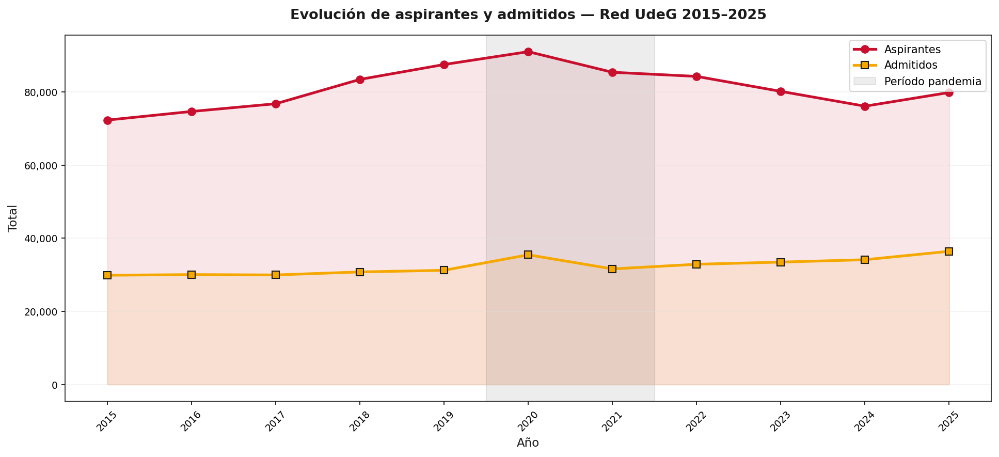
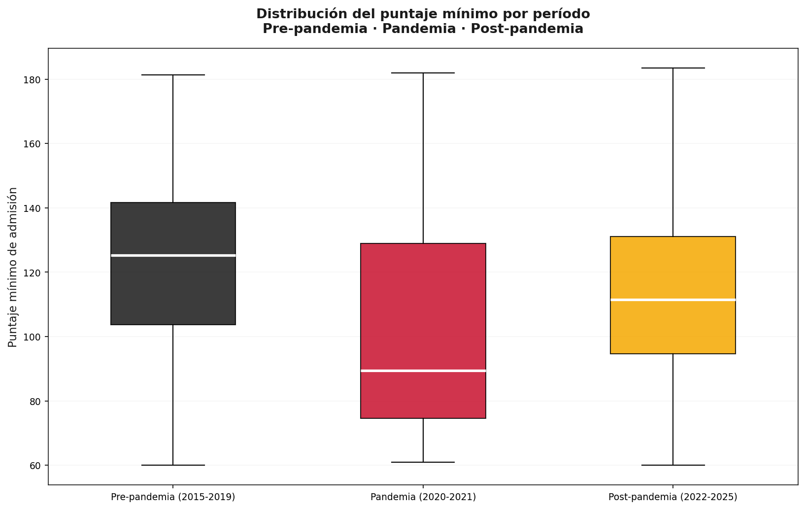
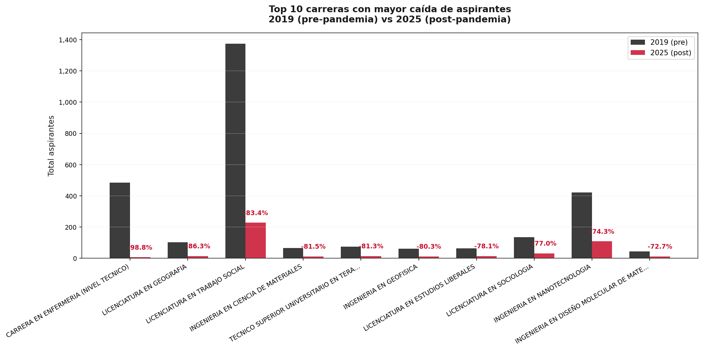
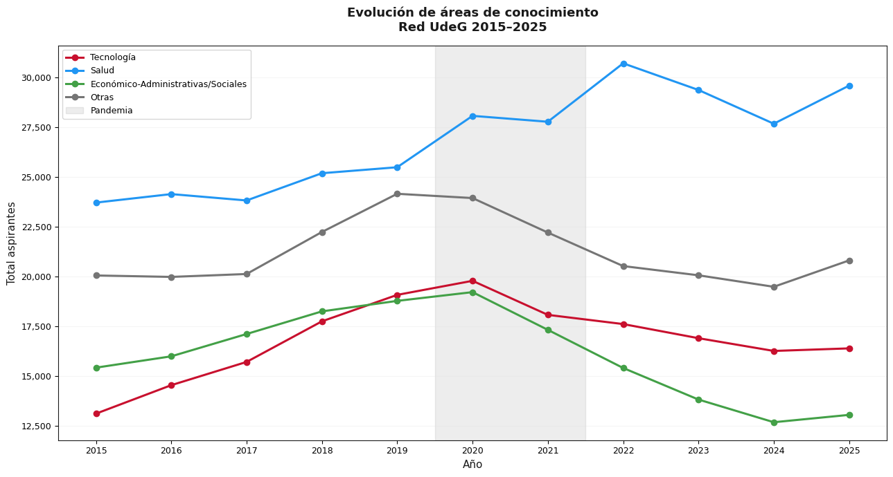

# El UDG Post-Pandemia: análisis de admisiones de la Red UdeG (2015-2025)

Análisis de **891,574 aspirantes y 356,073 admitidos** en 19 centros universitarios de la Universidad de Guadalajara, para medir cómo cambiaron la demanda, la selectividad y las preferencias académicas antes, durante y después de la pandemia de COVID-19.

**Autor:** Oscar Alejandro González Carrillo · Licenciatura en Inteligencia Artificial y Ciencia de los Datos, CUGDL
**Origen:** proyecto de la materia Probabilidad y Estadística I · **Reporte completo:** [`docs/reporte_udg_post_pandemia.pdf`](docs/reporte_udg_post_pandemia.pdf)



## Hallazgos principales

1. **Entrar a la UdeG es competitivo, pero depende de la carrera y del campus.** De 2015 a 2025 se admitió al 39.94% de los aspirantes. Los centros metropolitanos admiten al 35.75% y los regionales al 54.13%.
2. **2020 es el año con más aspirantes de toda la serie (91,022).** Sin examen presencial, la admisión se basó en el promedio y los admitidos (35,483) superaron el cupo (34,110). Hay 109 registros carrera-ciclo con más admitidos que aspirantes.
3. **Después de la pandemia ingresar es más fácil.** La tasa de admisión pasó de 35.70% en 2019 a 45.64% en 2025: los aspirantes bajaron de 91,022 (2020) a 76,123 (2024) mientras el cupo creció.
4. **La selectividad por puntaje no se recuperó.** La mediana del puntaje mínimo cayó de ≈125 (pre-pandemia) a menos de 90 (pandemia) y se recuperó solo a ≈111 (post-pandemia).
5. **La demanda está muy concentrada.** Medicina acumula 128,122 aspirantes, más del doble que Abogado (51,215), la segunda carrera más solicitada. La mayoría de los programas admite a casi todos sus aspirantes (mediana de la tasa de admisión: 76.9%).
6. **Las carreras sociales y humanísticas son las que más demanda perdieron entre 2019 y 2025:** Trabajo Social (−83.4%), Geografía (−86.3%), Sociología (−77.0%). El técnico en Enfermería cayó 98.8%.
7. **La demanda se concentra en pocos campus.** El CUCS recibió 187,365 aspirantes y admitió a 38,850. CUCEA (60,700) y CUCEI (47,385) admiten más estudiantes. En CUNORTE los admitidos (7,740) superan a los aspirantes (7,471), reflejo de los ajustes de 2020.

| Periodo | Aspirantes | Admitidos | Cupo | Puntaje mín. promedio | Tasa de admisión |
|---|---:|---:|---:|---:|---:|
| Pre-pandemia (2015-2019) | 394,740 | 151,991 | 161,720 | 123.50 | 38.50% |
| Pandemia (2020-2021) | 176,414 | 67,110 | 67,940 | 101.88 | 38.04% |
| Post-pandemia (2022-2025) | 320,420 | 136,972 | 149,481 | 113.79 | 42.75% |

*El periodo post-pandemia tiene 4 años y el pre-pandemia 5; los totales absolutos no son directamente comparables, las tasas sí.*

| Puntaje mínimo por periodo | Carreras con mayor caída 2019 → 2025 |
|---|---|
|  |  |

### Áreas de conocimiento (figura tomada del reporte)



Salud se consolida como el área con más aspirantes y Económico-Administrativas/Sociales cae de forma sostenida desde 2020. Esta figura proviene del reporte en PDF: la clasificación de carreras por área no está versionada en este repositorio (ver [limitaciones](#limitaciones)).

## Cómo está construido

| Capa | Herramientas |
|---|---|
| Base de datos | MySQL: modelo relacional con catálogos (`centro_universitario`, `ciclo_escolar`, `carrera`) y tabla de hechos (`admision`) |
| Limpieza y carga | Normalización de nombres de carreras y centros, 5 formatos de archivo distintos |
| Análisis | Python: pandas, SQLAlchemy |
| Visualización | Matplotlib con paleta institucional |
| Entrega | Notebooks de Jupyter, reporte en PDF |

Detalle de los problemas de datos encontrados en las fuentes oficiales: [`docs/calidad_de_datos.md`](docs/calidad_de_datos.md).

## Estructura del repositorio

```
├── notebooks/
│   ├── 01_analisis_red_udg.ipynb     # análisis de toda la Red UdeG (tablas y 12 gráficas)
│   └── 02_cugdl_admisiones.ipynb     # caso de estudio: programas presenciales del CUGDL
├── sql/
│   ├── 01_schema.sql                 # esquema de la base de datos
│   ├── 02_datos.sql                  # catálogos y admisiones 2015-2025
│   └── queries/consultas_clave.sql   # consultas analíticas principales
├── data/processed/                   # tablas exportadas (Excel y CSV)
├── reports/figures/                  # gráficas en PNG
├── docs/                             # reporte PDF y calidad de datos
├── requirements.txt
└── .env.example
```

## Cómo reproducirlo

1. Instala las dependencias: `pip install -r requirements.txt`
2. Carga la base en MySQL (**el primer script borra y recrea `udg_analisis` si ya existe**):
   ```bash
   mysql -u root -p --default-character-set=utf8mb4 < sql/01_schema.sql
   mysql -u root -p --default-character-set=utf8mb4 < sql/02_datos.sql
   ```
3. Copia `.env.example` como `.env` y escribe tu usuario y contraseña de MySQL.
4. Abre y ejecuta `notebooks/01_analisis_red_udg.ipynb`. La celda de validación comprueba que las cifras coincidan con las del reporte.

## Caso de estudio: CUGDL

El notebook `02_cugdl_admisiones.ipynb` analiza los 5 programas presenciales del Centro Universitario de Guadalajara (Ciberseguridad, Creatividad Digital, Inteligencia Artificial y Ciencia de los Datos, Inteligencia Financiera y de Negocios, Tecnologías Biomédicas). En el ciclo 2025B tuvieron 1,067 aspirantes, 600 admitidos y una tasa de admisión de 56.2%. Son programas nuevos con solo 3 ciclos de datos (2024B, 2025A y 2025B), así que el análisis es exploratorio.

## Limitaciones

- **Análisis descriptivo:** muestra cambios y asociaciones, no demuestra que la pandemia los haya causado.
- **Deserción y egreso no incluidos:** no existen datos estandarizados y continuos en los informes de rectoría.
- **Admisión cubre 2015-2025:** los ciclos 2005-2014 no se cargaron.
- **Clasificación por áreas de conocimiento:** aparece en el reporte pero su código no está en este repositorio.
- **Fuentes oficiales con errores y formatos cambiantes** (ver `docs/calidad_de_datos.md`).

## Próximos pasos (V2)

- Ampliar la serie histórica a todos los años del portal.
- Versionar y documentar la clasificación por áreas de conocimiento.
- Consolidar programas con nombres distintos y corregir los nombres pendientes.
- Obtener datos de deserción y egreso por transparencia.
- Publicar los resultados en un formato interactivo para futuros aspirantes.

## Fuente de los datos

Resultados de admisión y puntajes mínimos publicados por la Coordinación General de Control Escolar de la Universidad de Guadalajara: <https://escolar.udg.mx/estadisticas-puntajes-minimos>. Este proyecto es independiente y no está afiliado a la UdeG.
